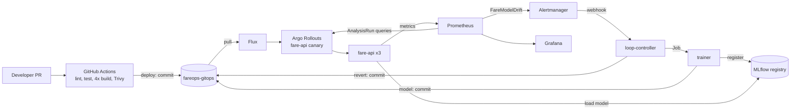

# FareOps: a self-healing MLOps platform — project report

Source for the report PDF (guide 11.4). Every number here was measured on the project
MacBook (Apple Silicon M1, 8 GB RAM) on 2026-10-11 and is backed by command output in
`docs/progress.md`. Items marked **TODO (team)** need a person: screenshots, the
proposal PDF and the individual contribution statements.

## 1. Problem and goals

A fare-prediction model degrades silently when the traffic it serves stops looking
like the data it was trained on. The usual response — someone notices, retrains,
redeploys — is slow and manual. FareOps closes that loop on a single laptop:

- serve a NYC taxi fare model (LightGBM) behind an API with model-level metrics;
- detect input drift (PSI) and live error (MAE) continuously;
- retrain automatically on drift, and only release a candidate that beats the current
  champion by at least 5% on recent data;
- release every change, code or model, as a canary judged by live metrics;
- roll a bad model back automatically, with Git as the single source of truth.

## 2. Architecture and the two paths



**Path A (code).** A merge to `main` runs lint and tests, builds four multi-arch
images, scans them with Trivy, and the `deploy` job commits the new image tags to
`fareops-gitops`. Flux pulls the commit and Argo Rollouts canary-releases `fare-api`.
Nothing pushes into the laptop: the cluster pulls from Git.

**Path B (model).** Prometheus fires `FareModelDrift` when any feature's PSI stays
above 0.2 for 3 minutes. Alertmanager calls the loop-controller, which starts a trainer
Job. The trainer fits on baseline plus recent traffic, gates the candidate against the
champion, registers it in MLflow and commits the new model version to the same GitOps
repo. From there the release mechanics are identical to Path A. A watcher in the
loop-controller promotes the champion alias on success, or commits a revert on failure.

## 3. Tool choices and rationale

| Stage | Tool | Why it suits an 8 GB laptop |
|---|---|---|
| VM / container runtime | Colima (5 GiB VM) | Free, native on Apple Silicon, far lighter than Docker Desktop |
| Kubernetes | k3d (k3s in a container) | One node, starts in seconds, bundles Traefik and metrics-server |
| IaC | Ansible (`make up`) | One idempotent playbook builds VM, cluster, Flux, namespaces and Secrets |
| GitOps | Flux, source + kustomize controllers only | Two small controllers (about 70 + 45 MiB measured) instead of a full suite |
| Manifests | Plain YAML + Kustomize | No Helm/templating layer to run or learn; `kubectl kustomize` validates locally |
| Progressive delivery | Argo Rollouts, replica-based canary | No service mesh: 1 of 3 pods gets about 33% via Traefik's per-request balancing |
| Model + registry | LightGBM, MLflow | Small, fast to train (about 20 s); registry gives versions, aliases and tags |
| Serving | FastAPI with `mlflow-skinny`, no pandas | Each `fare-api` pod uses about 94 MiB |
| Observability | Prometheus, Alertmanager, Grafana | Standard stack; dashboard and rules provisioned from Git |
| CI | GitHub Actions, GHCR | Multi-arch builds (amd64 + arm64) and Trivy gate off the laptop |

All versions are pinned in `versions.md`; GitHub Actions are pinned to commit SHAs.

## 4. Pipeline walkthrough

1. PR opens → `test` job: `ruff check`, `pytest` (23 tests across four services).
2. Merge to `main` → four `build` jobs (fare-api, trainer, loop-controller, mlflow):
   multi-stage non-root images, `linux/amd64,linux/arm64`, Trivy gate, push to GHCR.
3. `deploy` job (enabled by the repository variable `ENABLE_DEPLOY`) rewrites the image
   tags in `fareops-gitops` through marker comments and commits
   `deploy: nikunj169/fareops@<sha7>`.
4. Flux applies the commit within about a minute.
5. The Rollout sets one canary pod (33%), waits 90 s, runs the AnalysisRun, goes to
   66%, waits 30 s, then 100%.

Measured (run `38137478918`, merge `7f95ef3`): `deploy:` commit `3914684` at 17:39:11 →
canary started 17:40:14 → AnalysisRun `Successful` 17:44:06 → `Healthy` 17:45:04.
**5 min 53 s** from commit to fully rolled out, with no manual step.

GitOps log after the demo (the audit trail):

```
ae984d8 | Nikunj_mahajan112 | revert: model v3 failed canary analysis, back to v2
565e05a | Nikunj_mahajan112 | model: deploy fare-model v3 (bad, mae=7.249)
603a9f6 | Nikunj_mahajan112 | model: deploy fare-model v2 (retrain, mae=3.324)
13c6281 | nikunj169         | chore: reset model to v1
9e4ae63 | Nikunj_mahajan112 | revert: model v3 failed canary analysis, back to v2
95e40ba | Nikunj_mahajan112 | model: deploy fare-model v3 (bad, mae=7.249)
c3d3b34 | Nikunj_mahajan112 | model: deploy fare-model v2 (retrain, mae=3.330)
3914684 | fareops-ci        | deploy: nikunj169/fareops@7f95ef3
cd4b260 | fareops-ci        | deploy: nikunj169/fareops@0b0e520
```

**TODO (team):** screenshot of the green CI run and of this log on GitHub.

## 5. The extension: a closed loop

**Drift metric.** Each `fare-api` pod keeps the last 1,000 requests and, every 50
requests, computes the Population Stability Index of three features (`trip_distance`,
`pickup_hour`, `is_airport_pickup`) against the reference profile stored with the model.
Alert rule: `max by (feature) (fare_api_feature_psi) > 0.2` for 3 minutes.

**Guards against looping.** The loop-controller skips an alert when a trainer Job is
running, when fewer than 900 s have passed since the last trigger, or when the Rollout
is not `Healthy`. A promoted model ships a new reference profile, so PSI falls back
below the threshold.

**Gate.** The candidate must satisfy `candidate_mae <= champion_mae * 0.95` on the
newest 20% of recent traffic. Measured: 3.33 vs 5.56 USD (run 1) and 3.32 vs 5.80 USD
(run 2).

**Canary analysis.** Three Prometheus queries, 4 measurements 30 s apart, at most 1
failure each:

| Metric | Condition | Good model (v2) | Bad model (v3) |
|---|---|---|---|
| `mae-ratio-canary-vs-stable` | < 1.25 | 0.49–0.74 | 9.6–10.8 → **Failed** |
| `p95-latency-seconds` | < 0.25 | 0.007–0.010 | 0.007–0.009 |
| `error-ratio` | < 0.02 | 0 | 0 |

The MAE check compares the canary against the stable pods at the same moment rather
than against a fixed number, so it stays meaningful when traffic itself shifts. The
queries end in `or vector(1)` / `or vector(0)` so that an empty result (no labelled
traffic) does not error the analysis; the risk is that a canary receiving no traffic
passes by default, which is why replay must keep running during rollouts.

**Rollback.** When the Rollout aborts, the watcher tags the version `canary=failed` in
MLflow and commits `revert: model v3 failed canary analysis, back to v2` to the GitOps
repo. Flux applies it and the Rollout returns to `Healthy`; the champion alias never
moved.

**Results (each scenario run twice).**

| Scenario | Run 1 | Run 2 | Manual commands after the trigger |
|---|---|---|---|
| 1. Drift → retrain → canary → promotion | 9 min 15 s | 9 min 52 s | none |
| 2. Bad model → canary fails → Git revert | 4 min 42 s | 4 min 42 s | none |

## 6. Observability

Grafana dashboard "FareOps - self-healing model" (9 panels, provisioned from Git):
requests/s, live MAE, feature PSI, p95 latency and pods per model version; 5xx ratio;
champion version; loop events; drift alert state.

Values read from the panels' queries during Scenario 1, run 1:

| Time | Requests/s | Live MAE (USD) | PSI airport / distance | Pods |
|---|---|---|---|---|
| 17:47:18 normal traffic | v1 14.9 | v1 2.05 | 0.0 / 0.01 | v1 ×3 |
| 17:49:35 drift | v1 15.0 | v1 6.24 | 6.6 / 1.6 | v1 ×3 |
| 17:53:11 canary | v1 10, v2 5 | v1 6.09, v2 4.96 | 18.4 / 5.8 | v1 ×2, v2 ×1 |
| 17:54:21 canary | v1 10, v2 5 | v1 5.88, v2 3.20 | 18.4 / 5.6 | v1 ×2, v2 ×1 |
| 17:56:43 promoted | v2 15.0 | v2 3.78 | 0.0 / 0.04 | v2 ×3 |

Healthy reference on normal traffic: **1.84 USD** MAE (6-minute average), p95 latency
15 ms, 0 errors.

**TODO (team):** dashboard screenshot taken during Scenario 1.

## 7. Resource usage and minimum specs

Full table and raw output: `docs/report/resources.md`. Summary under 15 requests/s:

- Node: 0.85–1.4 CPU cores, 1.96–2.69 GiB of the 5 GiB VM.
- Largest pods: MLflow 364–371 MiB (limit 512), Grafana 220–227 MiB (limit 256),
  loop-controller ~100 MiB, each fare-api ~94 MiB.
- Trainer Job: about 1 core and 296 MiB for roughly 20 s.

Minimum specs: Apple Silicon, 8 GB RAM, macOS 13+, 25 GB disk.

## 8. Challenges and deviations

Full list with evidence: `docs/deviations.md`. The ones that mattered:

1. **A bug in the retrain path.** The trainer downloaded the champion's artifacts into
   the same temp directory it then tried to create for the candidate
   (`FileExistsError`). Only `retrain` mode hits it, so every earlier gate passed and
   the first real drift-triggered retrain crashed after a passing gate. Fixed by using
   a separate directory, with an end-to-end regression test that fails without the fix.
2. **MLflow 3.17 exceeds 512 MiB by default.** Its background job system starts one
   worker per CPU and was OOM-killed. Disabled with two environment variables; it now
   idles at about 360 MiB within the original limit.
3. **Deploys are not zero-downtime on 8 GB.** A deploy changes four image tags at once;
   pulling them saturated the node (357% CPU), probes timed out, pods were killed and
   about 5.7 minutes of requests failed before it self-healed. Pre-pulling images onto
   the node before the deploy commit reduced that to 17 failed requests.
4. **The GitOps token had no write access.** Not visible until the first component had
   to push; the first `deploy` job failed with HTTP 403. Replaced with a token scoped
   to `fareops-gitops` with Contents: read and write.
5. **Port 8080 was taken on loopback** by an unrelated local Jenkins, so the ingress is
   reached on the Mac's LAN address.
6. Dependency pins: `pyarrow` stepped down to 25.0.1 for MLflow; `numpy` added to the
   loop-controller image for the offline install.

Known limitations: labels arrive instantly in the replay (real labels are delayed); a
freshly started pod computes PSI on a small window and can briefly put the drift alert
into *pending*; the loop-controller reverts model versions only, not code deploys.

## 9. Rubric evidence map

| Criterion (marks) | Evidence |
|---|---|
| Proposal and architecture (3) | **TODO (team):** proposal PDF; diagram in section 2; rationale table in section 3 |
| Version control and collaboration (2) | Two repos; PRs #1–#16 in `fareops`. **Open:** `main` is not protected, and Git history shows a single contributor |
| CI/CD (4) | `.github/workflows/ci.yml`: lint, tests, multi-arch build, Trivy gate, GitOps bump; Flux sync; Path A measured in section 4 |
| Containers and Kubernetes (5) | Multi-stage non-root images; Rollout, Deployments, Jobs, PV/PVC, RBAC, Ingress, probes, resource limits in `fareops-gitops/apps` |
| Config management / IaC (2) | Idempotent Ansible playbook (`make up`: `failed=0`, second run `changed=0`); all cluster state in `fareops-gitops` |
| Monitoring and observability (3) | Prometheus scrape configs, two alert rules, Grafana dashboard provisioned from Git, model-level metrics (section 6) |
| Cutting-edge extension (4) | Section 5: drift-triggered retraining, champion gate, canary with Prometheus analysis, automatic GitOps rollback; both scenarios twice |
| Report, demo and viva (2) | This report; `docs/demo-runbook.md`; **TODO (team):** backup video |

## 10. Individual contributions

**TODO (team):** one paragraph per member, matching the ownership table in the guide
(11.1). Note for honesty: the commit history currently has one human author.
